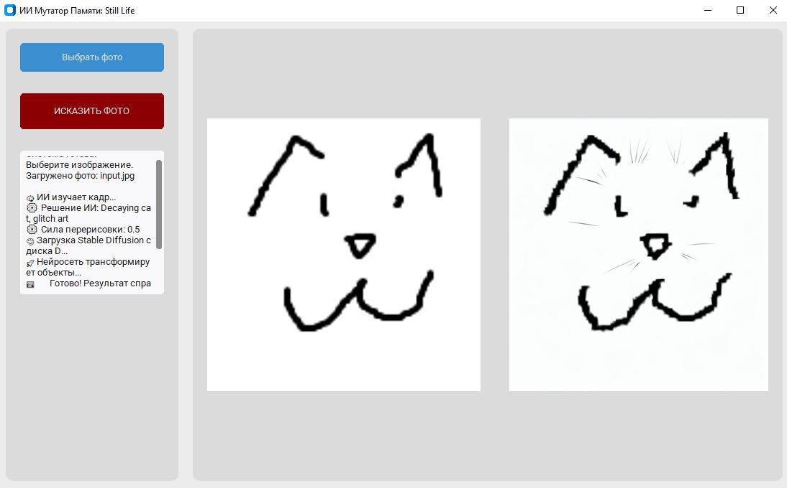
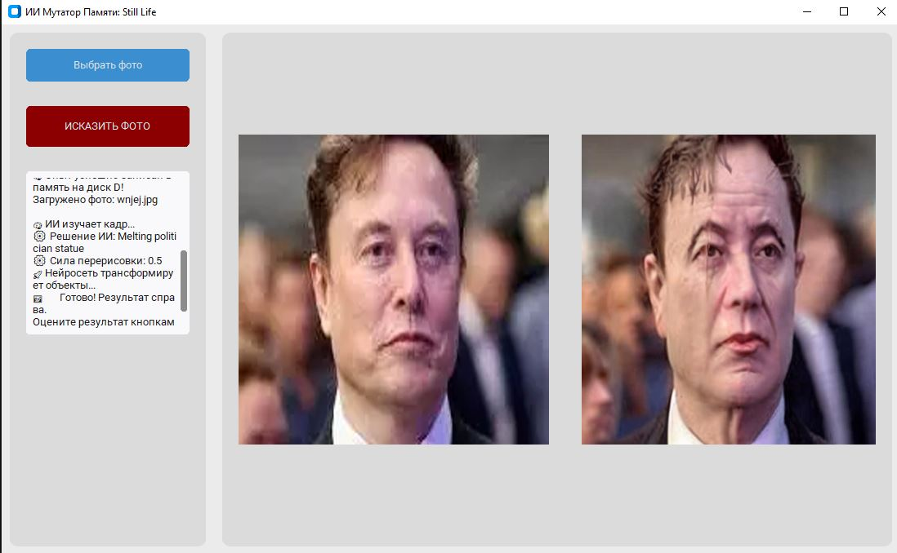
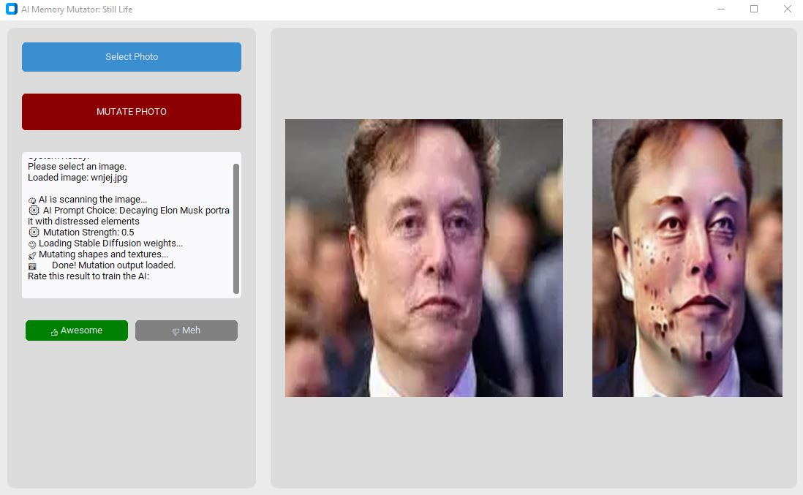

# AI Memory Mutator: Still Life

An intelligent generative art application with a graphical interface that mutates regular photos into decaying, corrupted "fading memory" artwork. Built as an autonomous AI agent loop where a vision model guides an image-to-image pipeline based on continuous training feedback.



## How it works
1. **Input:** You upload any image into the modern dark-themed GUI.
2. **Analysis:** The local multi-modal model **Llava** scans the image, reads its past experience files, and generates a decay text prompt.
3. **Mutation:** **Stable Diffusion (v1.5)** completely redraws objects, melting shapes and breaking patterns to fit the "Still Life decay" aesthetics.
4. **Reinforcement Learning:** You rate the output using "Awesome" or "Meh" buttons. The application automatically appends successful mutations into its persistent text memory, refining future decisions.

---

## Example of Mutation (Before / After)

| Original Photo | Mutated Still Life Result |
| -------------- | ------------------------- |
|  |  |

---

## 🛠️ Installation & Setup

### 1. Prerequisites
Make sure you have **Python 3.10** (or newer) installed on your system.

### 2. Automatic Setup (Windows)
1. Download and install **Ollama** from the official website: https://ollama.com
2. Launch Ollama (ensure the llama icon is running in your system tray).
3. Double-click the `install_requirements.bat` file inside this folder. It will automatically download all necessary Python libraries and fetch the 4.7 GB **Llava** vision model.

### 3. Run the App
Launch the main application file from your terminal:
```bash
python ai_app.py
```

## 💾 Model Weights Storage
To keep your C:\ drive clear of massive neural network weights:
* If a **D:\ drive** is present on the computer, the application creates a `D:\ai_models\` folder to safely store the Stable Diffusion pipeline checkpoints (~4 GB) and the training log file `ai_memory.txt`.
* If no D:\ drive is found, everything safely falls back into a local folder right inside the project directory.
